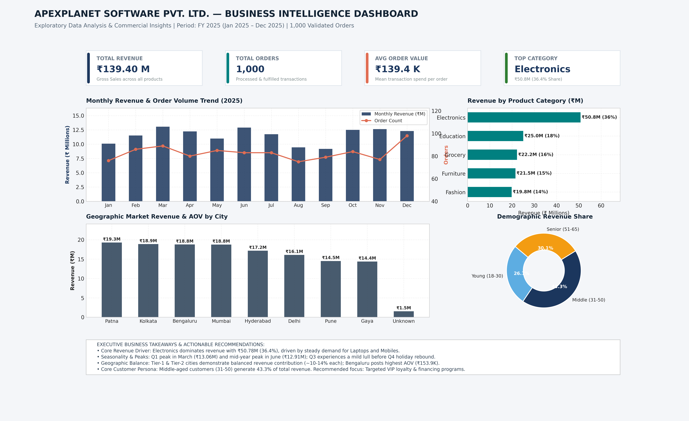

# ApexPlanet Software Pvt. Ltd. — Data Analytics Internship
## Task 2: Exploratory Data Analysis (EDA) & Business Intelligence


---

## 1. Project Overview & Context
This repository contains the completed **Task 2: Exploratory Data Analysis (EDA) & Business Intelligence** project for the **ApexPlanet Software Pvt. Ltd.** Data Analytics Internship.

The goal of this project is to perform an end-to-end data analytics workflow on a real sales dataset (`Data/ApexPlanet_DataAnalytics_Dataset.xlsx`):
1. **Inspect and audit** data hygiene, identifying missing values, data types, and primary key anomalies.
2. **Clean and transform** the data reproducibly using Python and Pandas.
3. **Perform descriptive statistics and univariate analysis** on numerical and categorical features.
4. **Answer 7 core commercial questions using SQL** executed on a local SQLite database (`sales_transactions`).
5. **Conduct multivariate analysis** to discover correlations, patterns, and trends.
6. **Design an executive-ready static Business Intelligence dashboard mock-up**.
7. **Document strategic business insights, limitations, and actionable recommendations**.

---

## 2. Business Intelligence Dashboard Preview

Below is the static executive dashboard mock-up synthesized from our clean data and analytical queries:



### Key Metrics At a Glance (FY 2025):
- **Total Revenue:** **₹139.40 Million**
- **Total Orders:** **1,000** fulfilled orders
- **Average Order Value (AOV):** **₹139,399.44**
- **Top Performing Category:** **Electronics** (₹50.78M revenue, 36.43% share)

---

## 3. Repository Structure

```
ApexPlanet-Task-2/
├── data/
│   ├── ApexPlanet_DataAnalytics_Dataset.xlsx   # Source dataset from Task 1 (immutable)
│   ├── cleaned_data.csv                       # Cleaned, standardized, and feature-engineered dataset
│   └── apexplanet_sales.db                    # Staged SQLite database for SQL queries
├── notebooks/
│   └── eda_analysis.ipynb                     # Runnable Jupyter Notebook with all outputs & charts
├── src/
│   ├── data_cleaning.py                       # Automated cleaning & SQLite staging script
│   ├── run_sql_queries.py                     # SQL query execution engine & CSV exporter
│   └── generate_visualizations.py             # Matplotlib/Seaborn visualization & dashboard suite
├── sql/
│   ├── business_queries.sql                   # Fully commented SQL script with 7 commercial questions
│   └── query_results/                         # Exported CSV query result tables (Q1 to Q7)
│       ├── q1_category_performance.csv
│       ├── q2_monthly_trend.csv
│       ├── q3_city_performance.csv
│       ├── q4_demographic_segments.csv
│       ├── q5_top_customers.csv
│       ├── q6_product_economics.csv
│       └── q7_transaction_tiers.csv
├── reports/
│   ├── EDA_Report.md                          # Comprehensive 14-section technical and business report
│   ├── dashboard_mockup.png                   # Executive-grade BI dashboard mock-up (300 DPI)
│   └── figures/                               # Exported charts referenced in reports
│       ├── 01_univariate_numerical_distributions.png
│       ├── 02_univariate_categorical_distributions.png
│       ├── 03_monthly_sales_trend.png
│       ├── 04_category_revenue_and_volume.png
│       ├── 05_city_sales_comparison.png
│       ├── 06_multivariate_correlation_heatmap.png
│       ├── 07_multivariate_scatter_and_relationships.png
│       └── 08_demographic_spending_distribution.png
├── requirements.txt                           # Minimal pinned project dependencies
├── .gitignore                                 # Standard Git hygiene exclusions
└── README.md                                  # Comprehensive documentation & presentation guide
```

---

## 4. Dataset Description

The analysis uses the actual dataset provided in `Data/ApexPlanet_DataAnalytics_Dataset.xlsx` (Sheet: `Sales_Dataset`).
- **Total Records:** 1,000 rows
- **Columns:** 12 raw columns -> 21 cleaned & engineered attributes
- **Time Range:** January 1, 2025 – January 1, 2026

### Raw Attributes
- `Order_ID`: Transaction identifier (contains 9 colliding records of `ORD100050` across distinct orders).
- `Order_Date`: Date of purchase (`YYYY-MM-DD`).
- `Customer_ID` & `Customer_Name`: Customer identifiers.
- `Age`: Customer age in years (contains 20 missing values / 2.0%).
- `Gender`: `Male` (51.1%) or `Female` (48.9%).
- `City`: 8 metro/regional cities (contains 13 missing values / 1.3%).
- `Product`: 6 products (`Laptop`, `Mobile`, `Book`, `Rice`, `Chair`, `Shoes`).
- `Category`: 5 categories (`Electronics`, `Education`, `Grocery`, `Furniture`, `Fashion`).
- `Quantity`: Units per order (1 to 10).
- `Unit_Price`: Realized item price in INR (₹145.78 to ₹49,997.53).
- `Total_Sales`: Gross transaction amount (`Quantity * Unit_Price`).

---

## 5. Data Cleaning Decisions

1. **Schema Standardization:** All column names converted to lowercase `snake_case`.
2. **Whitespace Trimming:** Leading/trailing spaces stripped from all string columns.
3. **Missing Value Handling:**
   - `age`: 20 missing records imputed using the **median age (41)**, preserving integer distribution. An `age_imputed_flag` was created for auditability.
   - `city`: 13 missing records imputed with `'Unknown'` to avoid skewing market share in real cities.
4. **Primary Key Collision Resolution:** The 9 colliding `ORD100050` records were preserved as distinct purchases and deduplicated using deterministic suffixing (`ORD100050`, `ORD100050_DUP1`, ..., `ORD100050_DUP8`).
5. **Feature Engineering:**
   - Extracted `year`, `month`, `month_name`, `year_month`, `quarter`, and `day_of_week`.
   - Discretized `age` into demographic segments: `Young Adult (18-30)`, `Middle-Aged (31-50)`, and `Senior (51-65)`.
6. **Integrity Validation:** Verified that `total_sales == quantity * unit_price` across all 1,000 records.

---

## 6. Business Questions Answered Using SQL

All queries were executed directly against `data/apexplanet_sales.db`. Standalone SQL script is in `sql/business_queries.sql`.

### Query Summary:
1. **Q1: Category Revenue & Volume Performance:**
   - **Electronics** leads revenue with **₹50.78M (36.43% share)** across 354 orders.
   - Education is 2nd (₹25.03M / 17.96%), followed by Grocery (₹22.23M), Furniture (₹21.52M), and Fashion (₹19.84M).
2. **Q2: Monthly Sales Trends & Seasonality:**
   - Peaks occurred in **March 2025 (₹13.06M)** and **June 2025 (₹12.91M)**.
   - Demand softens in August (₹9.45M) and September (₹9.18M), before rebounding in Q4 (November achieved highest AOV: ₹163,995).
3. **Q3: Regional Performance by City:**
   - Patna (₹19.29M, 13.84%) and Kolkata (₹18.88M, 13.55%) lead in order count.
   - **Bengaluru achieved the highest Average Order Value (₹153,881.76)**.
4. **Q4: Demographic Breakdown by Age Group & Gender:**
   - The **Middle-Aged group (31-50)** generates **43.28% of total revenue** (Male: ₹31.06M, Female: ₹29.27M).
   - Spending is balanced between genders (51.98% Male vs 48.02% Female).
5. **Q5: Top 10 High-Value Customers:**
   - Top 10 spenders each contributed between ₹462,701 and ₹493,677, driven by 10-unit orders of premium SKUs.
6. **Q6: Product Economics & Unit Pricing:**
   - Laptops (₹25.44M) and Mobiles (₹25.34M) lead revenue, followed closely by Books (₹25.03M). Shoes generated ₹19.84M.
7. **Q7: Transaction Tiers (Pareto Concentration Risk):**
   - High-Value orders (>= ₹250k) represent only **17.0% of orders** but drive **41.62% of revenue**.
   - Orders above ₹100k account for **84.71% of total revenue**.

---

## 7. Setup & Execution Guide

### Prerequisites
- Python 3.10 or higher
- VS Code or preferred editor
- Git

### Step 1: Clone the Repository
```bash
git clone <YOUR_REPOSITORY_URL>
cd ApexPlanet-Task-2
```

### Step 2: Create and Activate a Virtual Environment
```bash
# Windows (PowerShell)
python -m venv venv
.\venv\Scripts\Activate.ps1

# macOS / Linux
python3 -m venv venv
source venv/bin/activate
```

### Step 3: Install Dependencies
```bash
pip install -r requirements.txt
```

### Step 4: Run the Complete Data Pipeline
```bash
# 1. Clean the raw Excel dataset and stage into SQLite
python src/data_cleaning.py

# 2. Execute SQL business queries and export CSV results
python src/run_sql_queries.py

# 3. Generate all EDA figures and the static dashboard mock-up
python src/generate_visualizations.py
```

### Step 5: Run the Jupyter Notebook
Open VS Code, navigate to `notebooks/eda_analysis.ipynb`, select the Python environment kernel, and click **Run All**.

---

## 8. LinkedIn Showcase Video Script (5–7 Minutes)

As part of the internship submission deliverables, use this structured presentation guide for your LinkedIn showcase video:

| Time | Slide / Screen View | Talking Points |
| :--- | :--- | :--- |
| **0:00 - 1:00** | Introduction & Project Identity | Introduce yourself, the ApexPlanet Software Pvt. Ltd. internship context, and the objectives of Task 2. Show the repository structure in VS Code. |
| **1:00 - 2:00** | Data Quality Audit & Cleaning | Explain how you audited 1,000 raw transaction rows, handled missing values in `Age` (median 41) and `City` ('Unknown'), and resolved the 9 colliding `ORD100050` records without losing transaction data. |
| **2:00 - 3:30** | SQL Business Queries & Results | Open `sql/business_queries.sql`. Showcase Query 1 (Electronics generating 36.4% of revenue), Query 3 (Bengaluru's ₹153.9K peak AOV), and Query 7 (High-value tier concentration: 17% of orders driving 41.6% of sales). |
| **3:30 - 4:30** | Multivariate Analysis & Heatmap | Walk through `reports/figures/06_multivariate_correlation_heatmap.png`. Explain the strong positive correlation between Total Sales, Unit Price ($r=0.697$), and Quantity ($r=0.638$), while distinguishing correlation from causation. |
| **4:30 - 5:45** | Executive Dashboard Mock-Up | Display `reports/dashboard_mockup.png`. Highlight the 4 core KPI cards, the 2025 monthly trajectory, and demographic breakdown. |
| **5:45 - 6:30** | Strategic Recommendations & Wrap-Up | Summarize key recommendations: buffer stock for Electronics, counter-seasonal promotions in August/September, and VIP customer retention. Thank ApexPlanet and mentors. |

---

## 9. Limitations & Future Work

- **Synthetic Price Modeling:** The dataset is an educational benchmark where unit prices for commodities (e.g., Rice, Books) range up to ₹50k.
- **Time Scope:** The data spans 12 operational months in FY 2025. Multi-year data would enable secular year-over-year CAGR calculations.
- **Customer Repeat Rate:** Most customers appear once, limiting deeper cohort retention analysis.
- **Future Enhancements:** Integrate machine learning customer segmentation (K-Means RFM clustering) and an interactive Power BI / Streamlit dashboard.

---

## 10. Author & Contact

- **Author / Intern:** Mohammed Farshan
- **Internship:** ApexPlanet Software Pvt. Ltd. — Data Analytics Internship
- **Task:** Task 2 — Exploratory Data Analysis (EDA) & Business Intelligence
- **LinkedIn:** [Insert your LinkedIn Profile Link here]
- **GitHub:** [Insert your GitHub Profile Link here]
- **Email:** [Insert your Email Address here]

