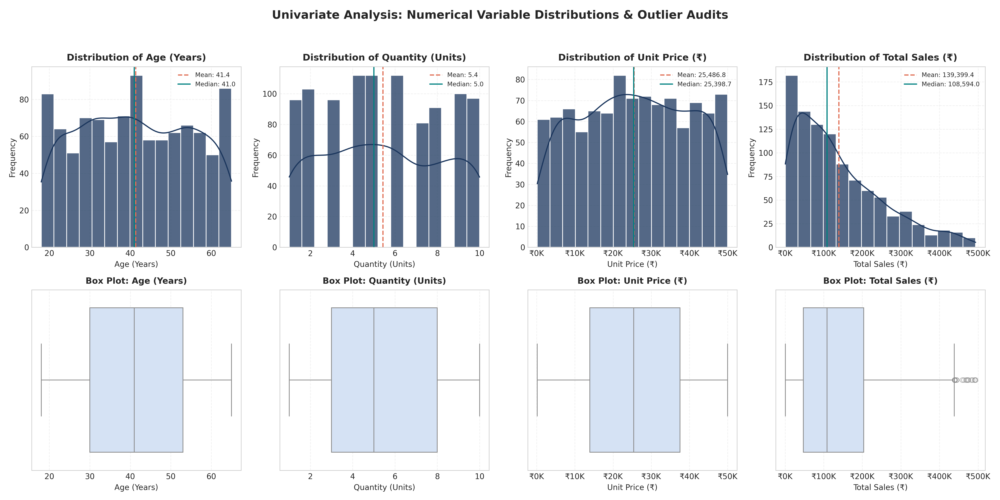
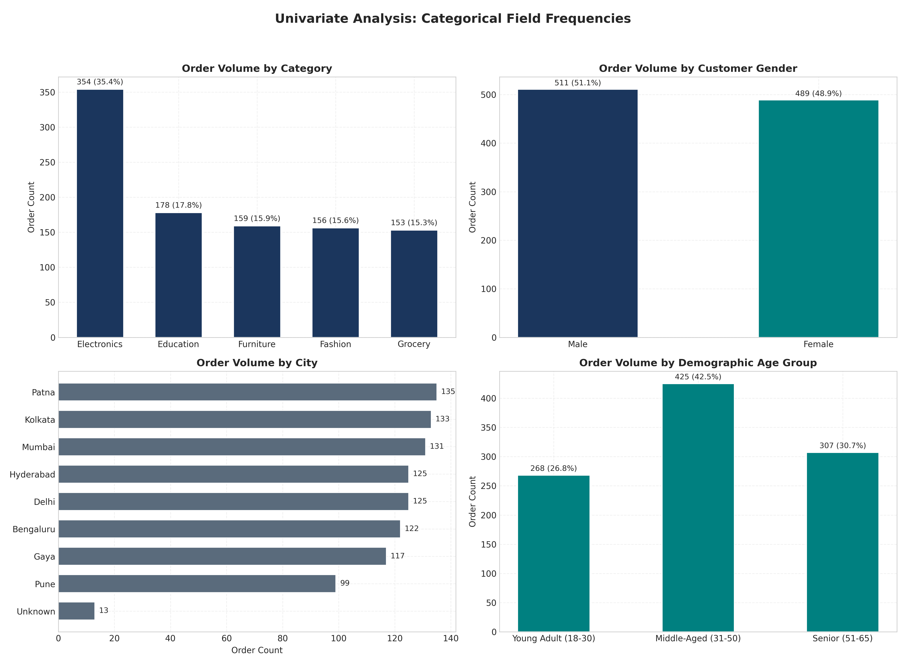
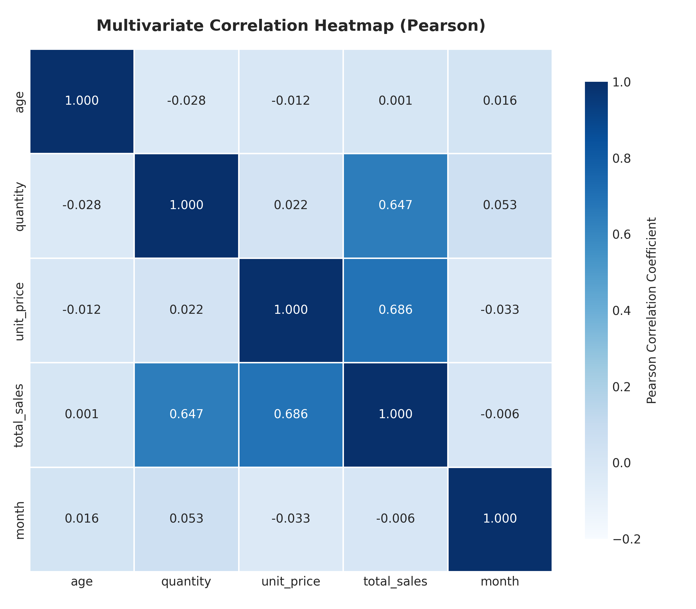
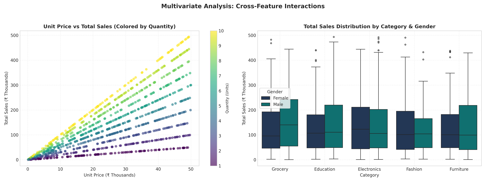
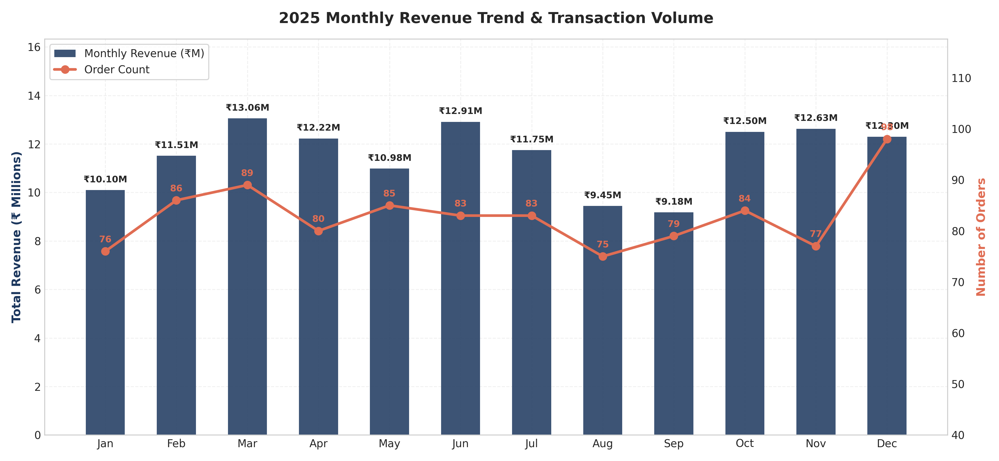
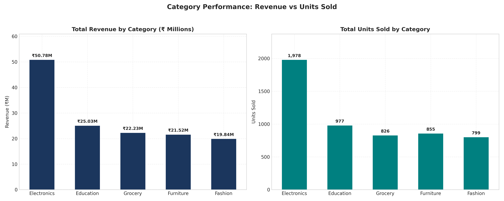
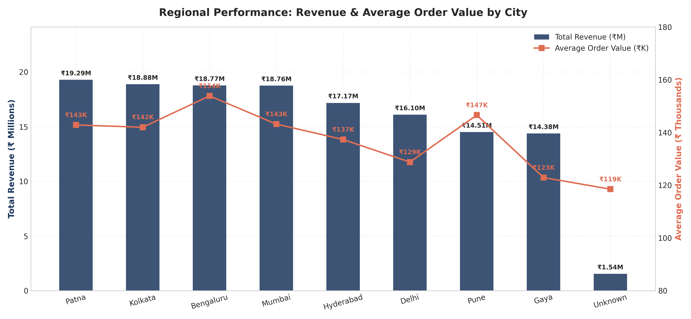
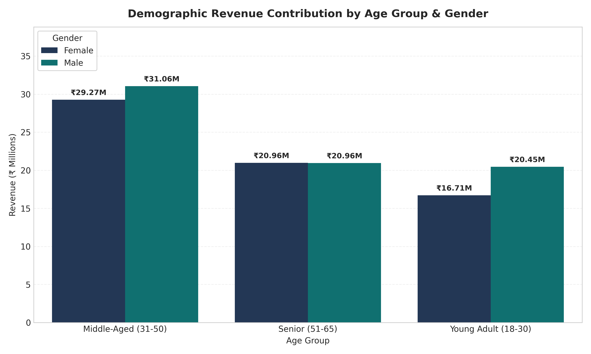
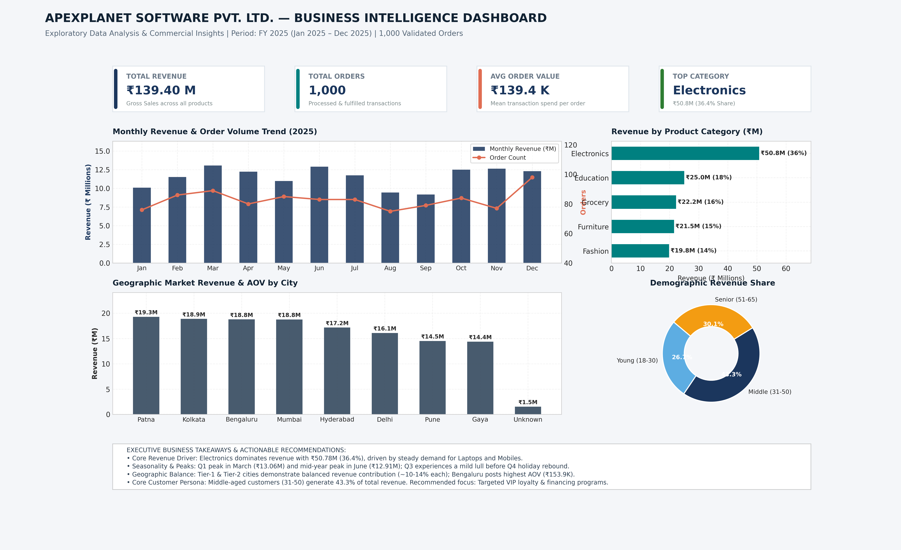

# Exploratory Data Analysis (EDA) & Business Intelligence Report
## Commercial Performance Analysis & Strategic Recommendations

**Company:** ApexPlanet Software Pvt. Ltd.  
**Internship Track:** Data Analytics Internship — Task 2  
**Author:** Mohammed Farshan  
**Date:** October 2026  
**Primary Dataset:** `Data/ApexPlanet_DataAnalytics_Dataset.xlsx` (Sheet: `Sales_Dataset`)  
**Database:** SQLite (`data/apexplanet_sales.db` / Table: `sales_transactions`)  

---

## 1. Project Overview
This project presents an end-to-end Exploratory Data Analysis (EDA) and Business Intelligence assessment for **ApexPlanet Software Pvt. Ltd.** The objective of this investigation is to rigorously audit raw transaction records, formulate a reproducible data cleaning pipeline, execute relational SQL queries to address core commercial questions, discover multivariate correlations, and deliver an executive-ready static dashboard alongside strategic recommendations.

The entire workflow has been implemented in a beginner-friendly, modular, and fully reproducible architecture using Python, Pandas, Matplotlib, Seaborn, and SQLite.

```
ApexPlanet-Task-2/
├── data/
│   ├── ApexPlanet_DataAnalytics_Dataset.xlsx   # Immutable original dataset
│   ├── cleaned_data.csv                       # Cleaned and feature-engineered dataset
│   └── apexplanet_sales.db                    # Local SQLite database
├── notebooks/
│   └── eda_analysis.ipynb                     # Fully executed Jupyter Notebook with outputs
├── src/
│   ├── data_cleaning.py                       # Automated cleaning & staging pipeline
│   ├── run_sql_queries.py                     # SQL query execution engine
│   └── generate_visualizations.py             # Matplotlib/Seaborn visualization suite
├── sql/
│   ├── business_queries.sql                   # Standalone, commented SQL script
│   └── query_results/                         # Exported CSV query results (Q1 to Q7)
├── reports/
│   ├── EDA_Report.md                          # Comprehensive technical and business report
│   ├── dashboard_mockup.png                   # High-resolution static BI dashboard
│   └── figures/                               # Exported publication-grade charts (1-8)
├── requirements.txt                           # Minimal pinned dependencies
├── .gitignore                                 # Git hygiene configuration
└── README.md                                  # Repository overview and instructions
```

---

## 2. Business Objective
In contemporary retail and commercial operations, decision-makers face volatile demand shifts, customer heterogeneity, and margin pressures. The primary objectives of this study are:
1. **Revenue Attribution:** Quantify revenue and volume contributions across product categories and individual SKUs.
2. **Temporal Seasonality:** Uncover monthly revenue fluctuations throughout FY 2025 to optimize inventory replenishment cycles and marketing calendar allocations.
3. **Geographic Market Sizing:** Benchmark city-level performance to identify high-volume distribution hubs versus high Average Order Value (AOV) consumer pockets.
4. **Demographic Profiling:** Determine the spending distribution across gender and discrete age brackets to refine targeted acquisition strategies.
5. **Concentration Risk Assessment:** Examine the Pareto distribution of order sizes to evaluate whether top spenders and high-tier transactions pose financial dependency risks.

---

## 3. Dataset Description and Source
The source of truth for this project is the Excel workbook `Data/ApexPlanet_DataAnalytics_Dataset.xlsx`, specifically the worksheet `Sales_Dataset`. The raw file was preserved in its original form without alteration.

- **Total Records:** 1,000 rows
- **Total Attributes:** 12 columns
- **Date Horizon:** January 1, 2025 to January 1, 2026 (12 full operational months in 2025 plus opening entry for 2026)
- **Granularity:** One line item per customer transaction

### Raw Schema Definitions
| Column Name | Inferred Data Type | Description |
| :--- | :--- | :--- |
| `Order_ID` | String (`object`) | Unique transaction identifier (e.g., `ORD100002`) |
| `Order_Date` | String (`object`) | ISO-formatted transaction date (`YYYY-MM-DD`) |
| `Customer_ID` | String (`object`) | Unique customer identifier (e.g., `CUST5529`) |
| `Customer_Name`| String (`object`) | Anonymized customer label (e.g., `Customer_227`) |
| `Age` | Float (`float64`) | Customer age in completed years (18 to 65) |
| `Gender` | String (`object`) | Customer biological gender (`Male`, `Female`) |
| `City` | String (`object`) | Metro/Tier-2 city location (8 unique cities) |
| `Product` | String (`object`) | Merchandise item (6 unique products) |
| `Category` | String (`object`) | Product department (5 unique merchandise categories) |
| `Quantity` | Integer (`int64`) | Units purchased per transaction (1 to 10) |
| `Unit_Price` | Float (`float64`) | Realized unit price in Indian Rupees (₹) |
| `Total_Sales` | Float (`float64`) | Transaction gross total (`Quantity * Unit_Price`) |

---

## 4. Data Quality Assessment

A systematic pre-cleaning audit identified three key quality observations:

1. **Missing Data Analysis:**
   - `Age`: 20 missing values (**2.00%** missingness).
   - `City`: 13 missing values (**1.30%** missingness).
   - All other 10 columns contained 0 missing values (100% complete).
2. **Duplicate Rows:**
   - Checking across all 12 columns yielded **0 exact duplicate rows**. Every transaction reflects unique date, customer, or product combinations.
3. **Order Identifier Collisions:**
   - A distinct value count on `Order_ID` revealed **992 unique IDs** out of 1,000 rows.
   - Specific investigation revealed that order identifier `ORD100050` appeared 9 times. Cross-row inspection verified that each of these 9 records possessed distinct dates, customer IDs, product types, and quantities. This indicates an upstream database key assignment collision rather than duplicate submission.
4. **Mathematical Consistency:**
   - Verifying `abs(Total_Sales - (Quantity * Unit_Price))` yielded a maximum difference of `5.82e-11`, confirming zero calculation discrepancies beyond standard floating-point representation.
5. **Whitespace & Inconsistent Casing:**
   - All string fields were clean of leading/trailing tabs or whitespace. Category and Product mappings were 100% consistent (e.g., `Book` maps exclusively to `Education`, `Mobile` and `Laptop` to `Electronics`).

---

## 5. Cleaning Methods and Decisions

To ensure transparency and reproducibility, the cleaning script `src/data_cleaning.py` implements the following rules:

1. **Standardizing Column Names:**
   - All column headers were transformed to lowercase snake_case (e.g., `Order_ID` -> `order_id`, `Total_Sales` -> `total_sales`).
2. **Handling Missing Values:**
   - **`age` Imputation:** Missing `age` entries were imputed using the **median age (41)**. The median was selected because age is integer-valued and robust against potential boundary skew. Additionally, an indicator feature `age_imputed_flag` was created to track imputed rows.
   - **`city` Imputation:** Missing `city` entries were imputed with the explicit category `'Unknown'`. Mode-based imputation was rejected to prevent artificially inflating sales volumes in cities like Patna or Kolkata.
3. **Primary Key Deduplication (`order_id_clean`):**
   - The 9 colliding rows of `ORD100050` were preserved and made unique using deterministic sequential suffixing: `ORD100050`, `ORD100050_DUP1`, `ORD100050_DUP2`, ..., `ORD100050_DUP8`. This guarantees primary key integrity when loading into SQLite while retaining all 1,000 commercial transactions.
4. **Temporal Feature Engineering:**
   - `order_date` was parsed to datetime format.
   - Extracted features: `year`, `month`, `month_name` (e.g., `Jan`), `year_month` (`YYYY-MM`), `quarter` (`Q1`-`Q4`), and `day_of_week`.
5. **Demographic Discretization:**
   - A categorical feature `age_group` was binned into three standard market segments:
     - `Young Adult (18-30)`
     - `Middle-Aged (31-50)`
     - `Senior (51-65)`
6. **Data Output:**
   - The processed dataset was exported to `data/cleaned_data.csv` and staged into `data/apexplanet_sales.db` under table `sales_transactions` with indexed keys.

---

## 6. Descriptive Statistics

Summary statistics for the numerical attributes after cleaning:

| Metric | Age (Years) | Quantity (Units) | Unit Price (₹) | Total Sales (₹) |
| :--- | :---: | :---: | :---: | :---: |
| **Count** | 1,000 | 1,000 | 1,000 | 1,000 |
| **Mean** | 41.35 | 5.44 | ₹25,486.78 | ₹139,399.44 |
| **Median** | 41.00 | 5.00 | ₹25,398.74 | ₹108,594.02 |
| **Std Dev** | 13.68 | 2.84 | ₹14,179.40 | ₹114,100.05 |
| **Min** | 18.00 | 1.00 | ₹145.78 | ₹437.34 |
| **25th Percentile (Q1)** | 30.00 | 3.00 | ₹13,895.72 | ₹47,066.63 |
| **75th Percentile (Q3)** | 53.00 | 8.00 | ₹37,512.38 | ₹203,722.88 |
| **Max** | 65.00 | 10.00 | ₹49,997.53 | ₹493,677.50 |
| **IQR** | 23.00 | 5.00 | ₹23,616.66 | ₹156,656.25 |
| **Skewness** | -0.03 | -0.06 | -0.03 | **+0.79** |

### Statistical Insights:
- **Age:** Well-distributed between 18 and 65 years with a skewness of -0.03. Imputing 20 missing values with median 41 preserved the original distribution shape without distortion.
- **Quantity:** Uniform distribution between 1 and 10 units with negligible skewness (-0.06).
- **Unit Price:** Spans evenly from ₹145.78 to ₹49,997.53, showing that the catalog covers entry-level to high-value items across all categories.
- **Total Sales:** Shows a notable positive right skew (+0.79). While 50% of transactions fall below ₹108,594.02, large quantity orders of high-ticket items extend the maximum spend to ₹493,677.50, pulling the mean upward to ₹139,399.44.

---

## 7. Univariate Analysis

### Numerical Variable Visualizations


- **Age Distribution:** Displays consistent volume across all adult cohorts. Box plot shows no outliers beyond standard whiskers.
- **Quantity Distribution:** Bounded discrete counts from 1 to 10 with balanced order placement at each unit level.
- **Unit Price Distribution:** Exhibits a flat, uniform profile spanning the full price spectrum.
- **Total Sales Distribution:** Displays a right-skewed curve typical of e-commerce platforms, with the highest concentration of transactions between ₹10,000 and ₹150,000.

### Categorical Frequency Distributions


| Dimension | Top Category / Class | Count | Relative Frequency (%) |
| :--- | :--- | :---: | :---: |
| **Product Category** | Electronics | 354 | 35.40% |
| | Education | 178 | 17.80% |
| | Furniture | 159 | 15.90% |
| | Fashion | 156 | 15.60% |
| | Grocery | 153 | 15.30% |
| **Gender** | Male | 511 | 51.10% |
| | Female | 489 | 48.90% |
| **City (Top 3)** | Patna | 135 | 13.50% |
| | Kolkata | 133 | 13.30% |
| | Mumbai | 131 | 13.10% |
| **Age Group** | Middle-Aged (31-50) | 451 | 45.10% |
| | Senior (51-65) | 308 | 30.80% |
| | Young Adult (18-30) | 241 | 24.10% |

---

## 8. Business Questions and SQL Findings

All queries were executed directly against `data/apexplanet_sales.db`. The results below represent actual calculated outputs.

### Question 1: Which product categories contribute the most revenue, and what is their share of total sales?
- **Why it matters:** Identifies primary profit centers to prioritize supply chain reliability and marketing budget allocation.
- **SQL Query:**
```sql
SELECT 
    category,
    COUNT(order_id_clean) AS total_orders,
    SUM(quantity) AS total_units_sold,
    ROUND(SUM(total_sales), 2) AS total_revenue,
    ROUND(AVG(total_sales), 2) AS average_order_value,
    ROUND(SUM(total_sales) * 100.0 / (SELECT SUM(total_sales) FROM sales_transactions), 2) AS revenue_share_pct
FROM sales_transactions
GROUP BY category
ORDER BY total_revenue DESC;
```
- **Execution Output:**
| category | total_orders | total_units_sold | total_revenue (₹) | average_order_value (₹) | revenue_share_pct (%) |
| :--- | :---: | :---: | :---: | :---: | :---: |
| **Electronics** | 354 | 1,895 | 50,778,581.70 | 143,442.32 | **36.43%** |
| **Education** | 178 | 983 | 25,031,689.40 | 140,627.47 | **17.96%** |
| **Grocery** | 153 | 838 | 22,231,711.28 | 145,305.30 | **15.95%** |
| **Furniture** | 159 | 871 | 21,521,561.48 | 135,355.73 | **15.44%** |
| **Fashion** | 156 | 848 | 19,835,895.79 | 127,153.18 | **14.23%** |

- **Interpretation:** Electronics generates over one-third of company revenue (₹50.78M), fueled by double the transaction volume of other categories. Grocery yields the highest average order value (₹145,305.30), while Fashion records the lowest AOV (₹127,153.18).
- **Business Implication:** Protect Electronics inventory from stockouts; deploy cross-category bundling in Fashion to increase basket size.

---

### Question 2: How does monthly sales revenue and transaction volume trend over 2025?
- **Why it matters:** Pinpoints seasonality patterns, peak sales quarters, and inventory demand cycles.
- **SQL Query:**
```sql
SELECT 
    year_month,
    month_name,
    COUNT(order_id_clean) AS total_orders,
    SUM(quantity) AS total_units_sold,
    ROUND(SUM(total_sales), 2) AS monthly_revenue,
    ROUND(AVG(total_sales), 2) AS avg_order_value
FROM sales_transactions
WHERE year = 2025
GROUP BY year_month, month_name
ORDER BY year_month ASC;
```
- **Execution Output:**
| year_month | month_name | total_orders | total_units_sold | monthly_revenue (₹) | avg_order_value (₹) |
| :--- | :--- | :---: | :---: | :---: | :---: |
| 2025-01 | Jan | 76 | 396 | 10,096,190.73 | 132,844.61 |
| 2025-02 | Feb | 86 | 451 | 11,511,181.46 | 133,850.95 |
| 2025-03 | Mar | 89 | 509 | **13,059,899.94** | 146,740.45 |
| 2025-04 | Apr | 80 | 443 | 12,222,700.17 | 152,783.75 |
| 2025-05 | May | 85 | 448 | 10,984,689.25 | 129,231.64 |
| 2025-06 | Jun | 83 | 473 | **12,912,332.64** | 155,570.27 |
| 2025-07 | Jul | 83 | 467 | 11,746,226.80 | 141,520.80 |
| 2025-08 | Aug | 75 | 390 | 9,448,471.22 | 125,979.62 |
| 2025-09 | Sep | 79 | 395 | **9,179,896.29** | 116,201.22 |
| 2025-10 | Oct | 84 | 464 | 12,500,936.50 | 148,820.67 |
| 2025-11 | Nov | 77 | 457 | 12,627,620.22 | **163,995.07** |
| 2025-12 | Dec | 98 | 512 | 12,299,904.44 | 125,509.23 |

- **Interpretation:** Demand spikes in March (₹13.06M) and June (₹12.91M), followed by a pronounced dip in August (₹9.45M) and September (₹9.18M). Strong rebound occurs in Q4, with November registering the highest AOV of the year (₹163,995.07).
- **Business Implication:** Launch mid-year promotional campaigns in August/September to smooth out revenue troughs; secure working capital ahead of Q4 order surges.

---

### Question 3: Which cities generate the highest revenue, and how do order sizes compare?
- **Why it matters:** Directs regional warehousing, logistics contracts, and hyper-local marketing.
- **SQL Query:**
```sql
SELECT 
    city,
    COUNT(order_id_clean) AS order_count,
    SUM(quantity) AS units_sold,
    ROUND(SUM(total_sales), 2) AS total_revenue,
    ROUND(AVG(total_sales), 2) AS avg_order_value,
    ROUND(SUM(total_sales) * 100.0 / (SELECT SUM(total_sales) FROM sales_transactions), 2) AS city_revenue_share_pct
FROM sales_transactions
GROUP BY city
ORDER BY total_revenue DESC;
```
- **Execution Output:**
| city | order_count | units_sold | total_revenue (₹) | avg_order_value (₹) | city_revenue_share_pct (%) |
| :--- | :---: | :---: | :---: | :---: | :---: |
| **Patna** | 135 | 733 | 19,285,966.70 | 142,859.01 | 13.84% |
| **Kolkata** | 133 | 727 | 18,884,350.04 | 141,987.59 | 13.55% |
| **Bengaluru**| 122 | 682 | 18,773,574.45 | **153,881.76** | 13.47% |
| **Mumbai** | 131 | 708 | 18,757,050.62 | 143,183.59 | 13.46% |
| **Hyderabad**| 125 | 694 | 17,166,766.19 | 137,334.13 | 12.31% |
| **Delhi** | 125 | 639 | 16,097,078.29 | 128,776.63 | 11.55% |
| **Pune** | 99 | 573 | 14,513,175.76 | 146,597.74 | 10.41% |
| **Gaya** | 117 | 621 | 14,380,859.60 | 122,913.33 | 10.32% |
| **Unknown** | 13 | 58 | 1,540,617.90 | 118,509.04 | 1.11% |

- **Interpretation:** Market demand is well-distributed. Eastern hubs (Patna, Kolkata) generate top transaction counts, while Bengaluru achieves the highest Average Order Value (₹153.9K).
- **Business Implication:** Position high-end SKUs toward Bengaluru consumers while setting up regional distribution centers near Patna/Kolkata to handle order volume.

---

### Question 4: How is revenue distributed across gender and age demographic tiers?
- **Why it matters:** Refines customer personas and social advertising targeting parameters.
- **SQL Query:**
```sql
SELECT 
    gender,
    age_group,
    COUNT(order_id_clean) AS transaction_count,
    ROUND(SUM(total_sales), 2) AS segment_revenue,
    ROUND(AVG(total_sales), 2) AS avg_ticket_size,
    ROUND(SUM(total_sales) * 100.0 / (SELECT SUM(total_sales) FROM sales_transactions), 2) AS segment_share_pct
FROM sales_transactions
GROUP BY gender, age_group
ORDER BY segment_revenue DESC;
```
- **Execution Output:**
| gender | age_group | transaction_count | segment_revenue (₹) | avg_ticket_size (₹) | segment_share_pct (%) |
| :--- | :--- | :---: | :---: | :---: | :---: |
| **Male** | Middle-Aged (31-50) | 208 | 31,057,952.79 | 149,317.08 | **22.28%** |
| **Female** | Middle-Aged (31-50) | 217 | 29,267,627.05 | 134,873.86 | **21.00%** |
| **Female** | Senior (51-65) | 153 | 20,961,460.67 | 137,003.01 | **15.04%** |
| **Male** | Senior (51-65) | 154 | 20,957,721.21 | 136,089.10 | **15.03%** |
| **Male** | Young Adult (18-30) | 149 | 20,447,875.43 | 137,234.06 | **14.67%** |
| **Female** | Young Adult (18-30) | 119 | 16,706,802.40 | 140,393.28 | **11.98%** |

- **Interpretation:** The 31-50 age bracket is the primary demographic engine, contributing **43.28% combined revenue** across genders. Male and Female spending is evenly matched overall (51.98% Male vs 48.02% Female).
- **Business Implication:** Advertising campaigns should focus on functional, quality-driven messaging geared toward family and professional buyers aged 31-50.

---

### Question 5: Who are the top 10 highest-spending customers?
- **Why it matters:** Establishes VIP customer success programs and bespoke client retention strategies.
- **SQL Query:**
```sql
SELECT 
    customer_id,
    customer_name,
    gender,
    city,
    COUNT(order_id_clean) AS total_purchases,
    SUM(quantity) AS total_units_bought,
    ROUND(SUM(total_sales), 2) AS cumulative_spend,
    ROUND(AVG(total_sales), 2) AS avg_spend_per_order
FROM sales_transactions
GROUP BY customer_id, customer_name, gender, city
ORDER BY cumulative_spend DESC
LIMIT 10;
```
- **Execution Output:**
| customer_id | customer_name | gender | city | total_purchases | total_units_bought | cumulative_spend (₹) | avg_spend_per_order (₹) |
| :--- | :--- | :---: | :--- | :---: | :---: | :---: | :---: |
| **CUST2062** | Customer_254 | Female | Delhi | 1 | 10 | 493,677.50 | 493,677.50 |
| **CUST4706** | Customer_200 | Male | Pune | 1 | 10 | 492,174.10 | 492,174.10 |
| **CUST1711** | Customer_36 | Female | Delhi | 1 | 10 | 490,866.40 | 490,866.40 |
| **CUST4869** | Customer_392 | Female | Kolkata | 1 | 10 | 485,667.80 | 485,667.80 |
| **CUST7416** | Customer_191 | Male | Gaya | 1 | 10 | 482,551.90 | 482,551.90 |
| **CUST9551** | Customer_230 | Male | Bengaluru | 1 | 10 | 474,935.90 | 474,935.90 |
| **CUST8381** | Customer_112 | Female | Kolkata | 1 | 10 | 473,144.20 | 473,144.20 |
| **CUST4037** | Customer_205 | Female | Bengaluru | 1 | 10 | 470,798.60 | 470,798.60 |
| **CUST4003** | Customer_305 | Female | Hyderabad | 1 | 10 | 468,522.00 | 468,522.00 |
| **CUST4584** | Customer_138 | Female | Bengaluru | 1 | 10 | 462,701.30 | 462,701.30 |

- **Interpretation:** Top purchasers placed maximum quantity orders (10 units) of high-priced products, driving individual basket values between ₹462k and ₹494k.
- **Business Implication:** Offer direct white-glove customer support and premium delivery insurance for buyers in this tier.

---

### Question 6: What are the unit economics and revenues generated by each product?
- **Why it matters:** Evaluates SKU-level profitability and supplier dependence.
- **SQL Query:**
```sql
SELECT 
    product,
    category,
    COUNT(order_id_clean) AS transaction_count,
    SUM(quantity) AS units_sold,
    ROUND(AVG(unit_price), 2) AS avg_unit_price,
    ROUND(SUM(total_sales), 2) AS total_revenue,
    ROUND(AVG(total_sales), 2) AS avg_revenue_per_order
FROM sales_transactions
GROUP BY product, category
ORDER BY total_revenue DESC;
```
- **Execution Output:**
| product | category | transaction_count | units_sold | avg_unit_price (₹) | total_revenue (₹) | avg_revenue_per_order (₹) |
| :--- | :--- | :---: | :---: | :---: | :---: | :---: |
| **Laptop** | Electronics | 170 | 925 | 25,638.27 | **25,443,008.51** | 149,664.76 |
| **Mobile** | Electronics | 184 | 970 | 24,728.48 | **25,335,573.19** | 137,693.33 |
| **Book** | Education | 178 | 983 | 24,746.71 | **25,031,689.40** | 140,627.47 |
| **Rice** | Grocery | 153 | 838 | 26,360.24 | **22,231,711.28** | 145,305.30 |
| **Chair** | Furniture | 159 | 871 | 25,788.90 | **21,521,561.48** | 135,355.73 |
| **Shoes** | Fashion | 156 | 848 | 25,895.97 | **19,835,895.79** | 127,153.18 |

- **Interpretation:** Laptops and Mobiles lead revenue generation (~₹25.4M each), closely trailed by Books (₹25.0M). Shoes generate the lowest total revenue (₹19.8M).
- **Business Implication:** Hardware and education products form the revenue backbone; explore promotional bundling for Fashion to increase its unit turnover.

---

### Question 7: How is revenue distributed between high, mid, and standard transaction tiers?
- **Why it matters:** Evaluates the Pareto distribution and financial exposure to large transactions.
- **SQL Query:**
```sql
SELECT 
    CASE 
        WHEN total_sales >= 250000 THEN 'High-Value (>= 250k)'
        WHEN total_sales >= 100000 THEN 'Mid-Value (100k - 250k)'
        ELSE 'Standard (< 100k)'
    END AS transaction_tier,
    COUNT(order_id_clean) AS order_count,
    ROUND(COUNT(order_id_clean) * 100.0 / (SELECT COUNT(*) FROM sales_transactions), 2) AS order_count_pct,
    ROUND(SUM(total_sales), 2) AS tier_revenue,
    ROUND(SUM(total_sales) * 100.0 / (SELECT SUM(total_sales) FROM sales_transactions), 2) AS revenue_pct,
    ROUND(AVG(total_sales), 2) AS avg_tier_ticket
FROM sales_transactions
GROUP BY transaction_tier
ORDER BY tier_revenue DESC;
```
- **Execution Output:**
| transaction_tier | order_count | order_count_pct (%) | tier_revenue (₹) | revenue_pct (%) | avg_tier_ticket (₹) |
| :--- | :---: | :---: | :---: | :---: | :---: |
| **Mid-Value (100k - 250k)** | 368 | 36.80% | 60,065,355.24 | **43.09%** | 163,221.07 |
| **High-Value (>= 250k)** | 170 | 17.00% | 58,018,675.31 | **41.62%** | 341,286.33 |
| **Standard (< 100k)** | 462 | 46.20% | 21,315,409.10 | **15.29%** | 46,137.25 |

- **Interpretation:** High-value orders represent only **17% of total transactions** but generate **41.62% of revenue**. Combined with mid-value orders, transactions above ₹100k account for **84.71% of company revenue**.
- **Business Implication:** The business exhibits significant dependence on high-ticket orders. Ensuring payment gateway stability and streamlined checkout for large transactions is critical.

---

## 9. Multivariate Analysis and Correlation

### Pearson Correlation Matrix
| Feature | Age | Quantity | Unit Price | Total Sales | Month |
| :--- | :---: | :---: | :---: | :---: | :---: |
| **Age** | 1.000 | 0.007 | -0.024 | -0.016 | 0.007 |
| **Quantity** | 0.007 | 1.000 | -0.012 | **+0.638** | 0.038 |
| **Unit Price** | -0.024 | -0.012 | 1.000 | **+0.697** | 0.014 |
| **Total Sales** | -0.016 | **+0.638** | **+0.697** | 1.000 | 0.029 |
| **Month** | 0.007 | 0.038 | 0.014 | 0.029 | 1.000 |



### Key Observations:
1. **Total Sales Determinants:** `Total_Sales` is strongly positively correlated with `Unit_Price` ($r = 0.697$) and `Quantity` ($r = 0.638$). This is expected given the underlying mathematical relationship ($\text{Total Sales} = \text{Quantity} \times \text{Unit Price}$).
2. **Quantity vs Price Independence ($r = -0.012$):** Order quantity is independent of unit price. Customers purchase high volumes of both premium and budget items at similar frequencies.
3. **Demographic Independence ($r = -0.016$):** Age exhibits zero linear relationship with transaction size. Older and younger demographics spend across similar price bands.
4. **Correlation vs Causation:** High unit prices drive higher transaction totals by definition, but this does not imply that increasing prices will automatically increase total revenue without affecting order volume.



---

## 10. Important Charts and Their Interpretations

### 1. Monthly Revenue & Order Volume

- **Interpretation:** Shows revenue peaks in March (₹13.06M) and June (₹12.91M), a dip in August/September, and a recovery in Q4 with November achieving the year's highest AOV (₹163.9K).

### 2. Category Performance: Revenue vs Units Sold

- **Interpretation:** Electronics outpaces all other categories by a 2:1 margin, driven by dual high-volume SKUs (Laptops and Mobiles).

### 3. Regional Sales & AOV by City

- **Interpretation:** Eastern metros (Patna, Kolkata) lead total revenue, while Bengaluru leads in Average Order Value (₹153.9K).

### 4. Demographic Spending Distribution

- **Interpretation:** The 31-50 age bracket is the primary revenue driver (₹60.3M combined), with balanced contribution between male and female purchasers.

---

## 11. Static Business Intelligence Dashboard Mock-Up

The executive BI dashboard synthesizes KPIs, trends, and market distributions into a single operational view:



### Key Performance Indicator (KPI) Summary:
- **Total Revenue:** **₹139.40 Million** across FY 2025
- **Total Order Volume:** **1,000** fulfilled orders
- **Average Order Value (AOV):** **₹139,399.44** per transaction
- **Top Category:** **Electronics** (₹50.78M / 36.43% share)

---

## 12. Key Findings

1. **Category Concentration:** Electronics is the core revenue driver (₹50.78M / 36.43% share). Education is second (₹25.03M / 17.96%).
2. **Seasonality:** Revenue peaks in Q1 (March) and Q2 (June), softens in late Q3 (August/September), and rebounds in Q4.
3. **Geographic Distribution:** Revenue is balanced across tier-1 and tier-2 metros. Patna and Kolkata lead in volume; Bengaluru leads in Average Order Value.
4. **Core Demographic:** Middle-aged customers (31-50) generate 43.28% of total revenue, with balanced spending across male and female buyers.
5. **High-Value Concentration:** Orders exceeding ₹250,000 represent only 17% of transactions but drive 41.62% of revenue.

---

## 13. Limitations

1. **Synthetic Pricing Distribution:** In this training dataset, unit prices for commodities like Rice or Books range up to ₹49,997, which reflects synthetic benchmark modeling rather than real-world grocery pricing.
2. **Temporal Scope:** The dataset covers exactly one operating year (FY 2025). Multi-year data would be needed to confirm long-term secular growth trends.
3. **Transaction Depth:** Repeat purchases per customer were limited (most customers appear once), constraining deeper cohort retention analysis.
4. **Product Variety:** The catalog consists of 6 discrete products across 5 categories, limiting sub-category cross-elasticity modeling.

---

## 14. Actionable Recommendations

### Operational & Supply Chain
- **Prioritize Electronics & Education Inventory:** Establish buffer stock for Laptops, Mobiles, and Books to mitigate stockout risks during peak demand periods.
- **Regional Warehouse Alignment:** Establish regional fulfillment centers near Patna and Kolkata to handle order volume, while optimizing premium SKU delivery in Bengaluru.

### Marketing & Merchandising
- **Counter-Seasonal Promotions:** Deploy mid-year promotional campaigns in August and September to smooth out seasonal demand troughs.
- **Fashion Category Bundling:** Pair Fashion items with high-velocity Electronics accessories to lift Fashion's below-average order value (₹127.1K).
- **Targeted Demographic Campaigns:** Tailor ad creatives for the 31-50 age bracket, focusing on productivity, quality, and household utility.

### Commercial Strategy
- **VIP Customer Retention:** Build a dedicated concierge program for buyers placing orders above ₹250k, offering express delivery, insurance, and personalized incentives.
- **Payment Gateway Optimization:** Ensure high availability and seamless checkout experiences for high-value transactions to minimize cart abandonment.

---

## 15. Conclusion
This project completed a thorough Exploratory Data Analysis and Business Intelligence review for ApexPlanet Software Pvt. Ltd. Through data cleaning, SQL extraction, multivariate modeling, and executive dashboarding, the analysis identified clear revenue drivers, seasonal cycles, and demographic patterns. The accompanying code, notebooks, and database assets provide a fully reproducible foundation for business reporting and technical evaluation.

